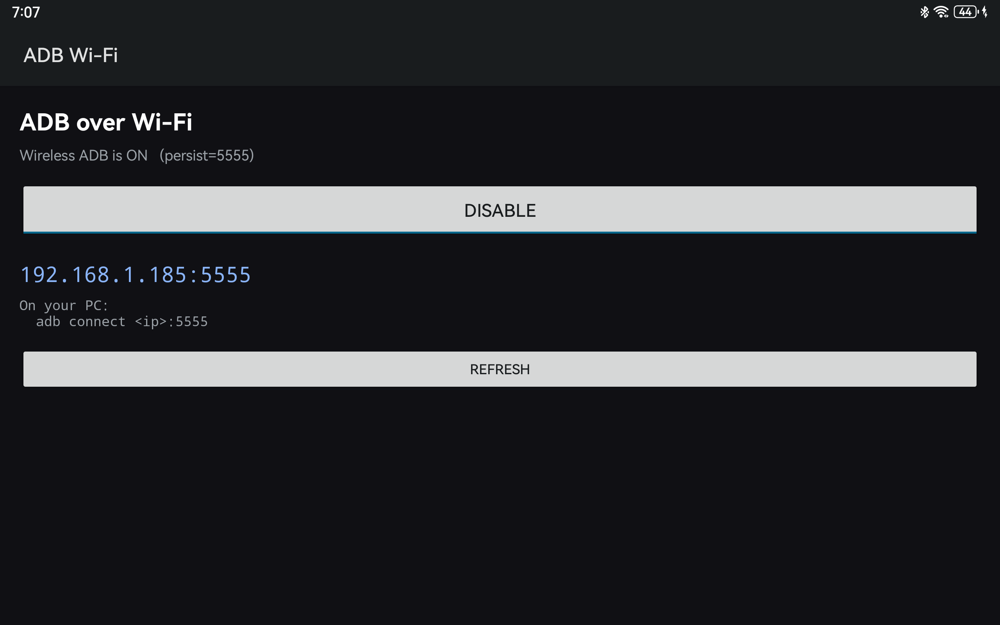

# ADB Wi-Fi — toggle widget for HarmonyOS

A 21 KB Android app that flips ADB-over-TCP on and off from the tablet, without a PC.

HarmonyOS on this device has **no** wireless-debugging toggle in Developer options —
the `adb_wifi_enabled` setting is silently refused even as root, and the Settings page
that would host it is absent from the C00 build. This app does what that toggle would
have done.



## Behaviour

| Button | Effect (as root) |
|---|---|
| **ENABLE** | `setprop service.adb.tcp.port 5555`, `setprop persist.adb.tcp.port 5555`, restart `adbd` |
| **DISABLE** | clears both properties, restarts `adbd` → USB only |

The `persist.` property is what makes the setting survive a reboot. The app reads back the
real property values rather than tracking its own state, so it is correct even if you change
things from a PC.

The IP address comes from `WifiManager` — the app needs no shell and no root for that part.

## Requirements

- Root (APatch, Magisk, KernelSU — anything that provides `su`)
- **First launch will report "no root".** Open APatch → Superuser and allow
  `ADB Wi-Fi`, then return to the app. Root grants are never auto-accepted,
  and that is by design.

## Build

No Gradle. `build.bat` drives `aapt2` → `javac` → `d8` → `zipalign` → `apksigner`.

Requirements:

- JDK 17 or newer
- Android SDK `build-tools;34.0.0` and `platforms;android-34`

Set `SDK=` at the top of `build.bat`, then:

```powershell
cmd /c build.bat
```

Output: `adbtoggle.apk` (~21 KB), signed with a generated test keystore.

### Two build traps, if you adapt this

- `javac --boot-class-path` is rejected when combined with `-target 11` on modern JDKs.
  Use `-classpath "%PLATFORM%"` instead.
- `d8` will not accept a **directory** of classes (`Unsupported source file type`).
  Pass an explicit list of `.class` files — `build.bat` builds that list in a `for /r` loop.

## Install

```powershell
adb install -r adbtoggle.apk
```

## Manual equivalent

Everything the app does is one shell command. It exists for convenience, not because the
operation is complicated:

```powershell
# enable
adb shell "su -c 'setprop service.adb.tcp.port 5555; setprop persist.adb.tcp.port 5555; setprop ctl.restart adbd'"

# disable
adb shell "su -c 'setprop service.adb.tcp.port \"\"; setprop persist.adb.tcp.port \"\"; setprop ctl.restart adbd'"
```

## Security

Enabling this makes the tablet accept ADB over the LAN permanently, **with root available**.
Any device on your network holding your ADB key has full control. Fine on a home network,
not on shared or public Wi-Fi. Disable it when you do not need it.

## Licence

MIT for this app's source. The bundled icon is generated, not third-party.
